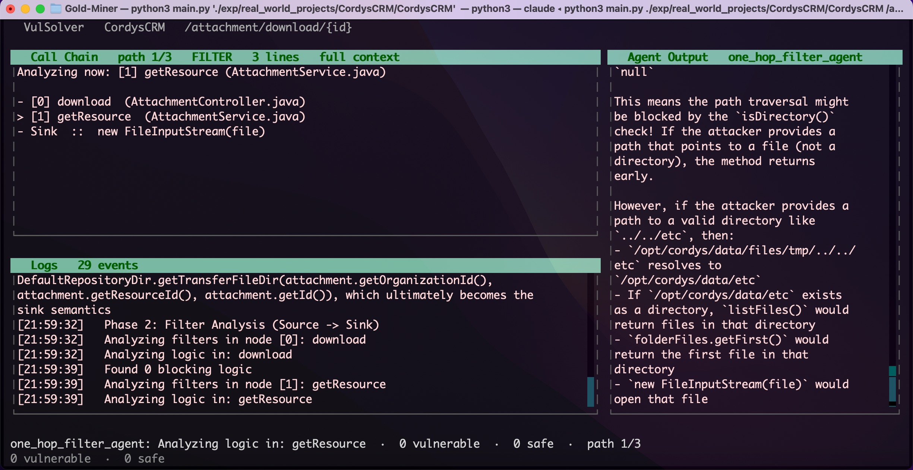

English | [中文](./README_CN.md)

# VulSolver

VulSolver is an LLM-based framework for repository-scale vulnerability detection through stepwise constraint solving. It distinguishes potentially dangerous source-to-sink call paths from paths whose checks, transformations, or application logic prevent exploitation.

Along each candidate path, VulSolver analyzes caller–callee hops, accounts for relevant off-path methods, and propagates a compact state of vulnerability-relevant data. The maintained state and supporting evidence are used to assess reachability and sink exploitability without repeatedly supplying the entire call chain.

The paper evaluates VulSolver on 1,023 [OWASP Benchmark](https://github.com/OWASP-Benchmark/BenchmarkJava) cases covering command injection, path traversal, and SQL injection, using six LLM backbones: GLM-4.7, Kimi-K2, DeepSeek-V3, DeepSeek-V4-Pro, GPT-4o, and GPT-4-Turbo. The table below reports **DeepSeek-V4-Pro**, the best-performing backbone overall. All rows use this same backbone, and all metrics, including F1, are percentages.

| Vulnerability Type | Accuracy | Precision | Recall | F1-Score |
| :--- | :--- | :--- | :--- | :--- |
| Overall | 99.41% | 100.00% | 98.87% | 99.43% |
| Command Injection | 99.20% | 100.00% | 98.41% | 99.20% |
| Path Traversal | 99.63% | 100.00% | 99.25% | 99.62% |
| SQL Injection | 99.40% | 100.00% | 98.90% | 99.45% |

The paper uses Kimi-K2 consistently for baseline comparisons and follow-up experiments unless otherwise specified; its overall benchmark F1 is 97.97%, with 100% recall. The best backbone can vary by vulnerability type: GLM-4.7 achieves the highest SQL injection F1 of 99.63%. These are separate configurations, not results combined into the table above.

VulSolver currently supports detection of Path Traversal, Command Injection, Code Injection, SQL Injection, and SSRF vulnerabilities. The controlled benchmark above covers command injection, path traversal, and SQL injection; it does not report benchmark scores for code injection or SSRF.

In the paper's real-world study, VulSolver analyzed ten widely used open-source projects (with star counts ranging from 1.4k to 38.2k at the time of measurement) and discovered **40+ vulnerabilities**. Selected CVE identifiers from earlier disclosures are listed below; this is not a complete inventory of the study's findings.

- CVE-2025-50745
- CVE-2025-5384
- CVE-2025-5385
- CVE-2025-5386
- CVE-2025-5387
- CVE-2025-5388
- CVE-2025-5389
- CVE-2025-5390

Discovery is automated. Reported findings are subsequently confirmed through manual code review, proof-of-concept validation in a test environment, and confirmation by the affected projects' maintainers. The number of valid alerts measures alert precision, not the fraction of all vulnerabilities discovered in a repository. Some CVE identifiers were assigned to other parties following concurrent duplicate reports.

# Installation and Configuration

Install the required dependencies with the following command:

```bash
pip3 install -r requirements.txt
```

Then configure the model settings in `config.yaml`:

```
llm:
  base_url: "base_url_for_the_default_model"
  api_key: "api_key_for_the_default_model"
  model: "model_name_for_the_default_model"

decision_llm:
  base_url: "base_url_for_the_complex_decision_model"
  api_key: "api_key_for_the_complex_decision_model"
  model: "model_name_for_the_complex_decision_model"
```

`decision_llm` is optional and is only used for complex logic decisions. If it is left empty, VulSolver will use the `llm` configuration everywhere.

> Since VulSolver is currently built on the Claude Code SDK for agent orchestration, please ensure your `base_url` supports the Anthropic API format.

# Usage

VulSolver performs in-depth code analysis at the interface level (HTTP endpoints, RPC entry points, etc.). You can analyze a project's interface with the following command:

```bash
python3 main.py <target_project_root_directory> <target_interface_name> # Example: python3 main.py '/tmp/helloProject' '/sample/hello'
```

To analyze multiple interfaces in one run, provide an interface list file with one interface per line:

```bash
python3 main.py <target_project_root_directory> --interface-file <interface_file>
```

For example:

```bash
python3 main.py '/tmp/helloProject' --interface-file './interfaces.txt'
```

If you prefer plain terminal output instead of the Textual TUI, add `--no-tui`:

```bash
python3 main.py <target_project_root_directory> <target_interface_name> --no-tui
```

You can also combine `--interface-file` and `--no-tui`:

```bash
python3 main.py <target_project_root_directory> --interface-file <interface_file> --no-tui
```

**Note:** Avoid using `sudo` or running as the root user.

During execution, VulSolver displays the analysis process in real-time via a TUI interface by default:



If `--no-tui` is specified, VulSolver prints progress and summary directly to the terminal.

# Viewing Results

After execution, you can find the result files `potential_paths.json` and `verified_paths.json` in the `results/<project_name>/<interface_name>` directory under the VulSolver root. The former records potential vulnerability call chains starting from the given interface, while the latter details whether each call chain contains a vulnerability and the locations of any logic that may prevent exploitation. Specifically, the contents of these files are as follows:

potential_paths.json:

```json
[
  {
    "InterfaceName": <analyzed_interface_name>,
    "Type": <vulnerability_type>,
    "SinkExpression": <sink_expression>,
    "Path": [
      {
        "file": <function_node_file_path>,
        "name": <function_node_name>,
        "source_code": <function_node_source_code>
      },
      <other nodes in the call chain, same format as above>
    ]
  },
  <other call chains, same format as above>
]
```

verified_paths.json:

```json
[
  {
    "InterfaceName": <analyzed_interface_name>,
    "Type": <vulnerability_type>,
    "SinkExpression": <sink_expression>,
    "Path": [
      {
        "file": <function_node_file_path>,
        "name": <function_node_name>,
        "source_code": <function_node_source_code>
      },
      <other nodes in the call chain, same format as above>
    ],
    "IsVulnerable": <whether_vulnerable>,
    "Confidence": <confidence_level>,
    "Summary": <analysis_summary>,
    "DataflowAnalysis": [
      {
        "NodeIndex": 0,
        "NodeName": <function_node_name>,
        "Parameters": <list_of_parameters_that_flow_to_sink>,
        "MemberVariables": <list_of_member_variables_that_flow_to_sink>
      },
      <dataflow information for other function nodes>
    ],
    "FilterLogics": [
      {
        "Dataflow": <dataflow_transmission_context>,
        "Description": <logic_description>,
        "File": <file_containing_the_logic>,
        "Lines": <lines_of_the_logic>
      },
      <other logics that may prevent exploitation>
    ]
  },
  <analysis results for other call chains, same format as above>
]
```

# Viewing Logs

After execution, you can find the log files `path_explore.log` and `path_verify.log` in the `logs/<project_name>/<interface_name>` directory under the VulSolver root. Both files record the detailed analysis process of VulSolver. The `path_explore.log` contains the detailed interface exploration process, with an exploration tree displayed at the end showing paths from the interface to various sinks, for example:

```
<VulSolver exploration tree building process>

BenchmarkTest00011.java#doPost
    ├── Sink
    └── Sink
```

The `path_verify.log` records the detailed verification process for call chains extracted from the exploration tree. Each entry begins with the call chain header, followed by the complete verification process:

```
Type: PathTraversal
Sink Expression: new java.io.File(param, "/Test.txt")

Call Chain:
  doPost → sink

Path Nodes:
  [0] doPost
      File: BenchmarkTest00011.java

<VulSolver verification process for this call chain>
```

# Integration with SAST

VulSolver consists of two modules—`path_explore` and `path_verify`. The former discovers call chains, while the latter verifies them. If you find that certain SAST tools have strong vulnerability detection capabilities but suffer from high false positive rates, you can combine SAST with VulSolver by using SAST to replace the `path_explore` module, and leveraging `path_verify` to further validate SAST alerts.

To do this, format your SAST alerts according to the `potential_paths.json` structure described above, then run the following command to verify the paths using VulSolver:

```bash
python3 -m path_verify.verify <target_project_root_directory> <path_to_potential_paths.json>
```
