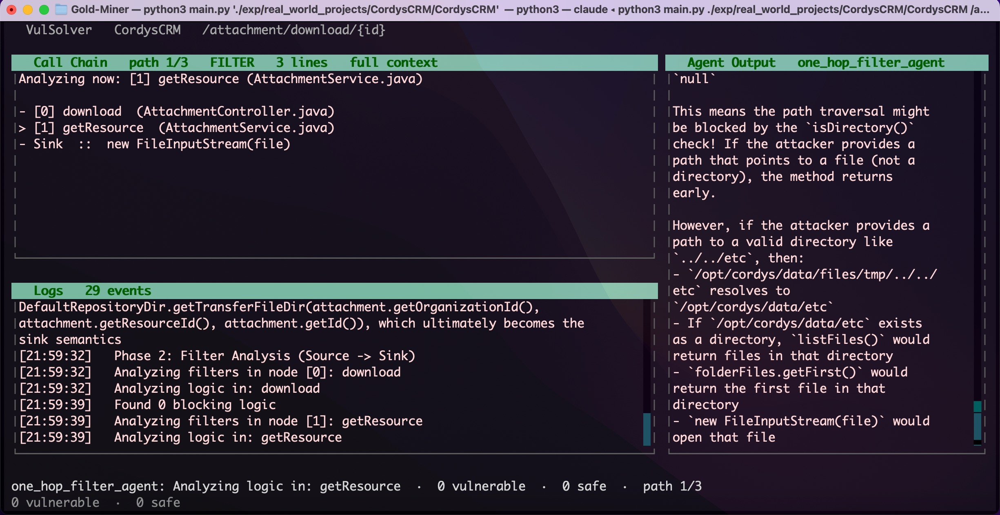

[English](./README.md) | 中文

# VulSolver

VulSolver 是一个通过逐步约束求解实现仓库级漏洞检测的 LLM 框架。它分析潜在的 source-to-sink 调用路径，区分可利用的路径与受到检查、数据变换或业务逻辑阻断的路径。

VulSolver 沿候选路径逐跳分析调用者与被调用者，考虑相关旁支方法的影响，并传播漏洞相关数据的紧凑状态。维护的状态及支持证据用于判断路径可达性和 sink 可利用性，避免在每一步反复提供整条调用链。

论文在 [OWASP Benchmark](https://github.com/OWASP-Benchmark/BenchmarkJava) 的 1,023 个用例上评估 VulSolver，覆盖命令注入、路径穿越和 SQL 注入，并测试了 GLM-4.7、Kimi-K2、DeepSeek-V3、DeepSeek-V4-Pro、GPT-4o 和 GPT-4-Turbo 六种模型。下表报告整体表现最好的 **DeepSeek-V4-Pro** 的结果，所有行均使用这一模型；包括 F1 在内的全部指标统一使用百分比。

| 漏洞类型 | 准确率 | 精确率 | 召回率 | F1-Score |
| :--- | :--- | :--- | :--- | :--- |
| Overall | 99.41% | 100.00% | 98.87% | 99.43% |
| Command Injection | 99.20% | 100.00% | 98.41% | 99.20% |
| Path Traversal | 99.63% | 100.00% | 99.25% | 99.62% |
| SQL Injection | 99.40% | 100.00% | 98.90% | 99.45% |

论文在基线比较及后续实验中默认统一使用 Kimi-K2，另有说明的除外；它在整个基准上的 F1 为 97.97%，召回率为 100%。不同漏洞类型的最佳模型可能不同，例如 GLM-4.7 的 SQL 注入 F1 最高，为 99.63%。这些结果来自不同配置，没有混合到上表中。

VulSolver 目前支持路径穿越、命令注入、代码注入、SQL 注入和 SSRF 漏洞检测。上面的受控基准只评估了命令注入、路径穿越和 SQL 注入，不包含代码注入或 SSRF 的基准测试分数。

论文的真实项目研究覆盖十个广泛使用的开源项目（统计时的 star 数为 1.4k–38.2k），发现了 **40+ 个漏洞**。以下列出部分早期披露的 CVE 编号，并非此次研究的完整漏洞清单。

- CVE-2025-50745
- CVE-2025-5384
- CVE-2025-5385
- CVE-2025-5386
- CVE-2025-5387
- CVE-2025-5388
- CVE-2025-5389
- CVE-2025-5390

漏洞发现过程自动执行，报告的发现随后经过人工代码审查、在测试环境中编写并执行 PoC 以及受影响项目维护者确认。有效告警的比例衡量的是告警精确率，不表示已经发现项目中的全部漏洞。由于与其他研究者同期重复报告，部分 CVE 编号被分配给了其他发现者。

# 安装与配置

通过以下命令安装 VulSolver 的必要依赖：

```bash
pip3 install -r requirements.txt
```

在 `config.yaml` 配置文件中补充模型调用信息：

```
llm:
  base_url: "普通模型的base_url"
  api_key: "普通模型的api_key"
  model: "普通模型的模型名称"

decision_llm:
  base_url: "复杂决策模型的base_url"
  api_key: "复杂决策模型的api_key"
  model: "复杂决策模型名称"
```

`decision_llm` 是可选配置，仅用于复杂逻辑决策时调用。如果将其留空，VulSolver 会统一使用 `llm` 配置。

> 由于 VulSolver 目前基于 Claude Code SDK 搭建必要的 agents，请确保你的 `base_url` 支持 Anthropic 的接口格式。

# 使用

VulSolver 以接口（HTTP 接口、RPC 接口等入口）为维度深入分析代码，通过以下简单的命令即可对项目的接口做深入分析：

```bash
python3 main.py <待分析项目根目录> <待分析项目接口名> # 例如：python3 main.py '/tmp/helloProject' '/sample/hello'
```

如果你希望一次分析多个接口，可以通过 `--interface-file` 提供一个接口列表文件，文件中每行一个接口：

```bash
python3 main.py <待分析项目根目录> --interface-file <接口列表文件>
```

例如：

```bash
python3 main.py '/tmp/helloProject' --interface-file './interfaces.txt'
```

如果你希望禁用 Textual TUI、直接在终端输出分析进度，可以添加 `--no-tui`：

```bash
python3 main.py <待分析项目根目录> <待分析项目接口名> --no-tui
```

你也可以将 `--interface-file` 和 `--no-tui` 组合使用：

```bash
python3 main.py <待分析项目根目录> --interface-file <接口列表文件> --no-tui
```

**注意：** 请勿使用 `sudo` 或以 root 用户身份运行。

执行过程中，VulSolver 默认会以 TUI 的形式实时展示模型分析过程：



如果指定了 `--no-tui`，VulSolver 会直接在终端输出分析进度和总结信息。

# 结果详情查阅

VulSolver 执行结束后，你可以在 VulSolver 根目录下的 `results/<项目名>/<接口名>` 看到名为 `potential_paths.json` 与 `verified_paths.json` 的结果文件。前者详细记录了从给定接口出发潜在的漏洞调用链条，后者详细记录了调用链条是否存在漏洞、以及其中导致漏洞无法利用的逻辑的位置等。具体而言，两个文件的内容如下：

potential_paths.json:

```json
[
  {
    "InterfaceName": <分析的接口名称>,
    "Type": <漏洞类型>,
    "SinkExpression": <sink的表达式>,
    "Path": [
      {
        "file": <该函数节点所在文件>,
        "name": <该函数节点名称>,
        "source_code": <该函数节点源码>
      },
      <调用链路上其他节点信息，格式同上>
    ]
  },
  <其他调用链路信息，格式同上>
]
```

verified_paths.json:

```json
[
  {
    "InterfaceName": <分析的接口名称>,
    "Type": <漏洞类型>,
    "SinkExpression": <sink的表达式>,
    "Path": [
      {
        "file": <该函数节点所在文件>,
        "name": <该函数节点名称>,
        "source_code": <该函数节点源码>
      },
      <调用链路上其他节点信息，格式同上>
    ],
    "IsVulnerable": <是否存在漏洞>,
    "Confidence": <置信度>,
    "Summary": <分析总结>,
    "DataflowAnalysis": [
      {
        "NodeIndex": 0,
        "NodeName": <该函数节点名称>,
        "Parameters": <当前函数中，所有最终流向 sink 的参数列表>,
        "MemberVariables": <当前函数中，所有最终流向 sink 的成员变量列表>
      },
      <其他函数节点的数据流信息>
    ],
    "FilterLogics": [
      {
        "Dataflow": <发生在什么数据流传递过程中>,
        "Description": <该逻辑的描述>,
        "File": <该逻辑所在文件>,
        "Lines": <该逻辑所在行>
      },
      <其他导致漏洞无法利用的逻辑>
    ]
  },
  <其他调用链路分析结果信息，格式同上>
]
```

# 日志详情查阅

VulSolver 执行结束后，你可以在 VulSolver 根目录下的 `logs/<项目名>/<接口名>` 看到名为 `path_explore.log` 与 `path_verify.log` 的日志文件。两者详细记录了 VulSolver 的分析过程。其中 `path_explore.log` 包含详细的接口探索过程，其结尾会展示该接口的探索树，记录了从该接口到若干 sink 的路径，例如：

```
<VulSolver 探索调用树的过程>

BenchmarkTest00011.java#doPost
    ├── Sink
    └── Sink
```

`path_verify.log` 则记录了对探索树上提取到的若干调用路径的分析详情，以调用链条开头，随后是整个链路的详细验证过程：

```
Type: PathTraversal
Sink Expression: new java.io.File(param, "/Test.txt")

Call Chain:
  doPost → sink

Path Nodes:
  [0] doPost
      File: BenchmarkTest00011.java

<VulSolver 验证该条链路的过程>
```

# 与 SAST 结合使用

VulSolver 总体上分为两个模块 —— `path_explore` 与 `path_verify`，前者用于发现调用链路，后者用于验证调用链路。如果你认为某些 SAST 的漏洞发现能力较强，但是误报较高，可以将 SAST 与 VulSolver 结合使用，用 SAST 替代 `path_explore` 模块，使用 `path_verify` 进一步验证 SAST 的告警。

你需要做的是将 SAST 的告警按照上文 `potential_paths.json` 的格式维护起来，然后执行如下命令即可使用 VulSolver 对路径做验证：

```bash
python3 -m path_verify.verify <待分析项目的代码根目录> <上文 potential_paths.json 的文件路径>
```
